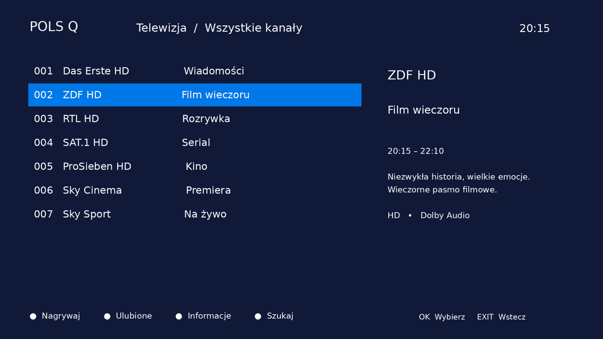
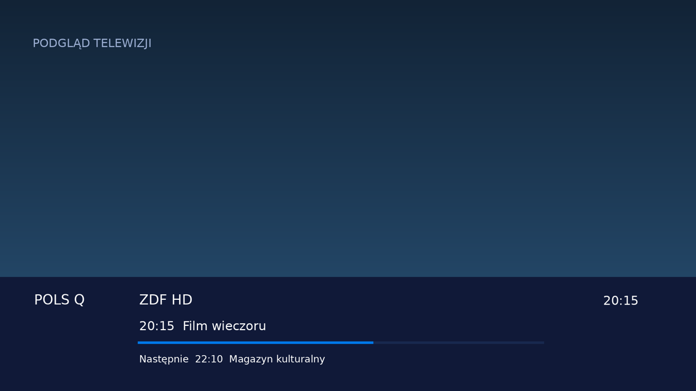
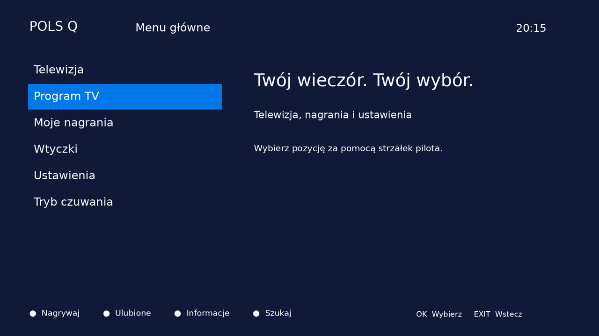
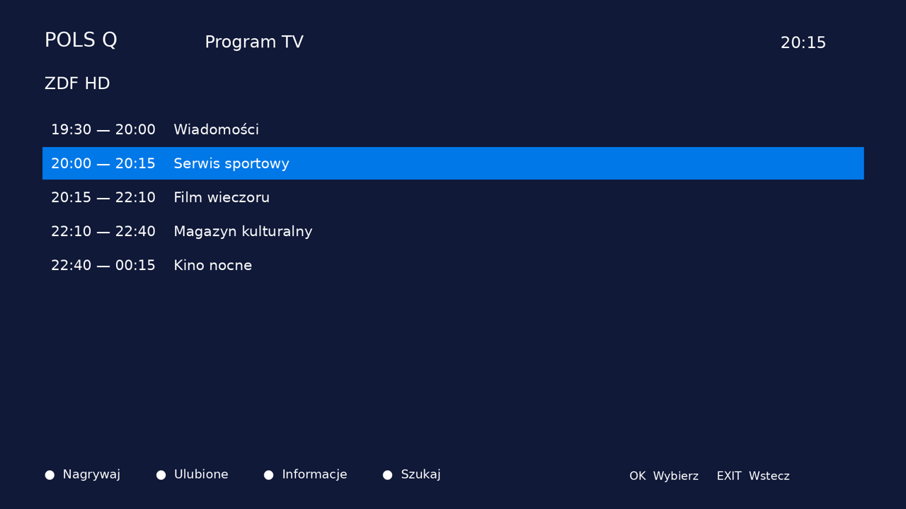
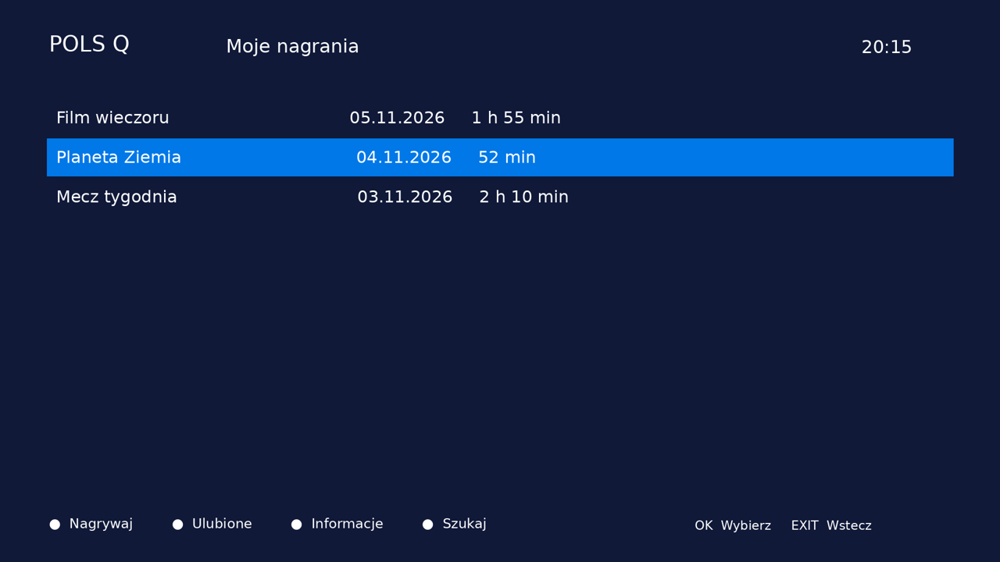
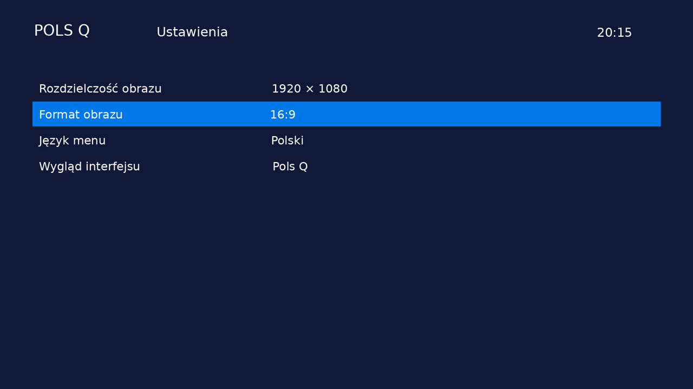

# Pols Q — skóra Enigma2 inspirowana SKY DE

Docelowy obraz: **OpenATV 8** (zgodnie z deklaracją użytkownika); model dekodera jeszcze nieustalony. Wersja wymaga testu na urządzeniu.

Wstępna skóra Full HD (1920×1080): granat, niebieskie zaznaczenie, duże litery i polskie opisy. Autorski projekt inspirowany SKY Q, bez oficjalnych logotypów i materiałów SKY.

## Wizualizacje

Podglądy są renderowane z geometrii `PolsQ/skin.xml` z przykładowymi danymi; nie są zrzutami działającego dekodera. Lista w urządzeniu otrzyma wygląd i dane z komponentów danego obrazu.

## Instalacja testowa

1. Zachowaj dostęp SSH i kopię aktualnego `/etc/enigma2/settings`.
2. Skopiuj katalog `PolsQ` do `/usr/share/enigma2/PolsQ`.
3. W ustawieniach interfejsu wybierz skórę PolsQ i zrestartuj GUI.
4. W razie problemów zatrzymaj Enigma2 (`init 4`), przywróć kopię settings i uruchom `init 3`.

Projekt wymaga czcionki `/usr/share/fonts/nmsbd.ttf`, typowej dla Enigma2. Jeśli jej nie ma, wskaż w sekcji fonts poprawną ścieżkę do czcionki na dekoderze.

## Zakres i ograniczenia

Zdefiniowane ekrany: Menu, ChannelSelection, InfoBar, EPGSelection (lista EPG), MovieSelection i Setup. Pozostałe ekrany korzystają z mechanizmu skór domyślnych danego obrazu. Nie dodano własnego portalu VOD ani siatki MultiEPG. Statyczne opisy w podglądzie ilustrują projekt, a nazwy kanałów, audycje i postęp w InfoBar korzystają ze źródeł Enigma2.

Zweryfikowano poprawność XML, geometrię i generowanie podglądów. Nie przeprowadzono testu na fizycznym dekoderze. Różne wersje OpenATV/OpenPLi mają różne komponenty i atrybuty list; to wersja 0.1 do dopasowania po ustaleniu modelu dekodera i obrazu. Nie traktuj jej jako gotowej, zweryfikowanej skórki produkcyjnej.

## Odtworzenie podglądów

Python 3 + Pillow: `python tools/build.py`. Skrypt generuje XML, PNG/WebP oraz lokalną paczkę `PolsQ-preview.zip`. Po ręcznej edycji XML nie uruchamiaj generatora bez przeniesienia zmian do skryptu — nadpisuje XML.
