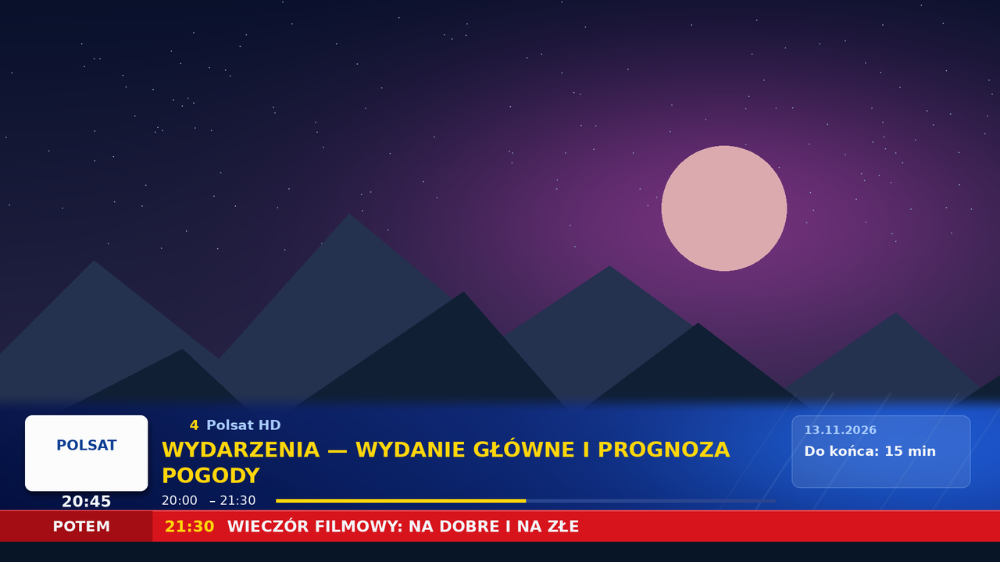
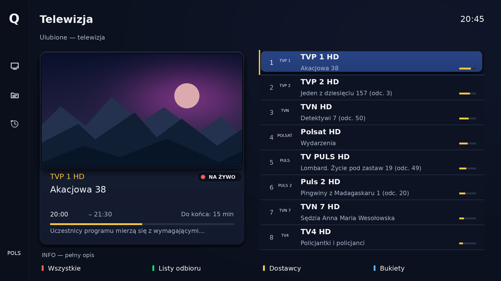
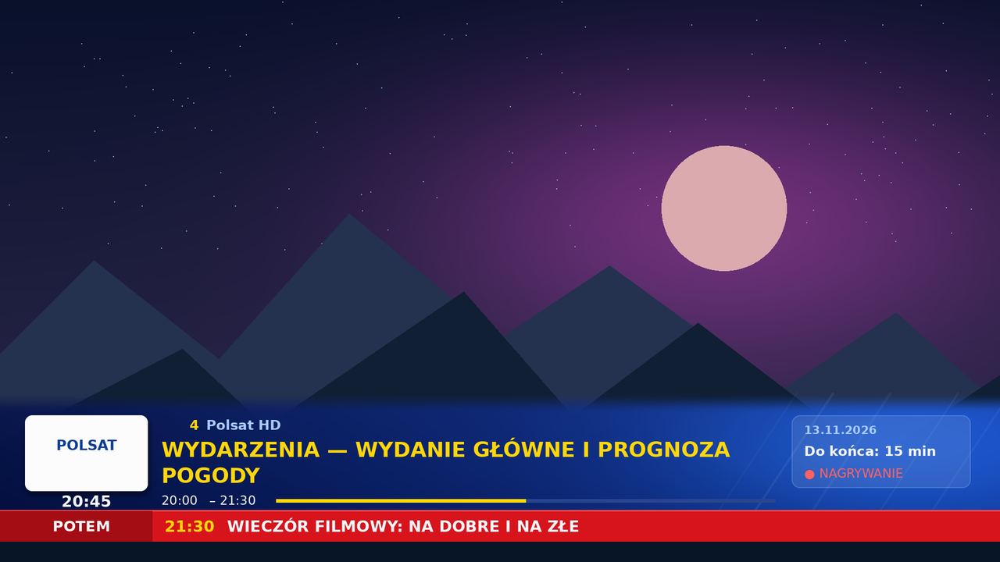
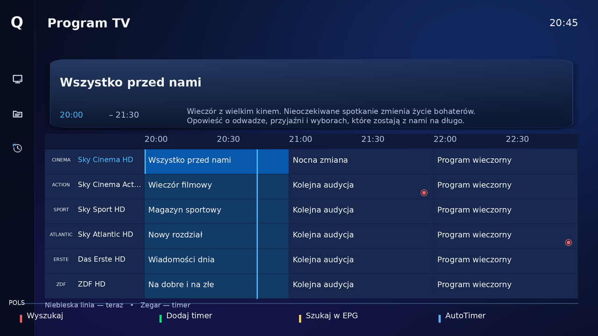
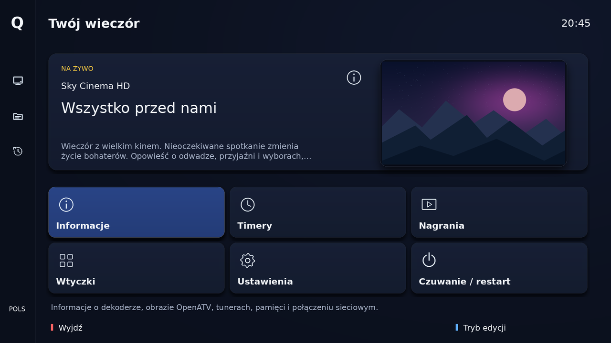
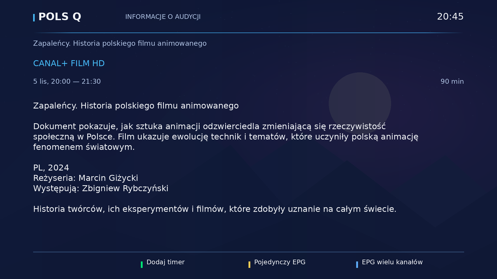
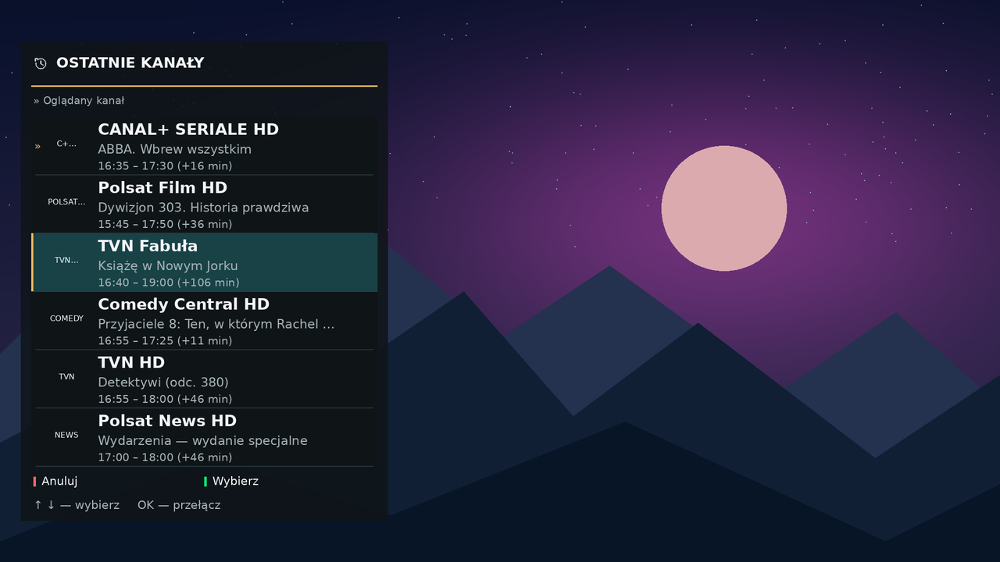

# Pols Q 0.4.2 — Enigma2 / OpenATV 8

Skóra Full HD 1920×1080 z granatowo-niebieską kolorystyką, żółtym akcentem i paskiem informacyjnym w stylu telewizyjnego „paska”. Projekt niezależny, bez oficjalnych logotypów SKY. To rozbudowana baza do testów na dekoderze, nie wierna kopia wszystkich funkcji SKY Q.

## Zakres

**64 definicje ekranów w każdym z dwóch wariantów**: PolsQ Standard i PolsQLarge / Duże napisy. Baza funkcjonalna pochodzi z udostępnionej przez użytkownika skóry [TvSat](https://github.com/Baniak88/enigma2-skin) na licencji MIT; zachowano oryginalną licencję. Szczegóły: [źródło i zmiany](docs/SOURCE.md).

- Menu i QuickMenu, telewizja/radio, bukiety, historia kanałów w bocznym panelu.
- Lista 8 kanałów z osobnymi liniami nazwy i audycji, pikonami i podglądem TV 16:9; także wariant bez TV.
- EPG pojedyncze, multi, graficzne, pionowe i PIG; opisy audycji, timery i konflikty nagrań.
- InfoBar w stylu paska TV (żółty tytuł, czerwony pasek z następną audycją), SecondInfoBar, nagrania, odtwarzacz, pauza/przewijanie i stan timeshiftu.
- Ustawienia, wybór skóry, dźwięk/napisy, wtyczki lista/siatka i dialogi.
- Instalator IPK, postęp, błędy, pakiety i logi; dwupanelowy FileCommander.
- Wtyczka **PolsQ — wygląd** do jawnego zapisania profilu listy i rozmiaru interfejsu.

## Nowości 0.4.2 — pasek informacyjny w stylu TV i nowe kolory



- **InfoBar w układzie „paska telewizyjnego”**: biała karta z logo kanału i zegarem pod nią, granatowo-niebieski pasek z **numerem kanału** (żółty) i nazwą kanału i **żółtym tytułem audycji WIELKIMI LITERAMI** (do dwóch linii), godziny, żółty pasek postępu. Panel po prawej: data, „Do końca: X min” i „● NAGRYWANIE”.
- **Czerwony pasek „POTEM”** na dole: godzina i tytuł następnej audycji z EPG. Wszystko jest statyczne — bez przewijania i bez timerów, więc pasek nie obciąża dekodera.
- **Kolory całej skóry dopasowane do paska**: granat i królewski błękit w tle, kartach i zaznaczeniu, **żółty akcent** (linie, zaznaczenie kafli i kanałów, paski postępu, linia „teraz” w EPG, ikony), jasnoniebieskie opisy. Kolorowe przyciski pilota pozostają w swoich kolorach.
- **Szybciej**: pasek, karta logo i panel to jeden obraz w natywnym rozmiarze, czerwony pasek to jednolite wypełnienia, pikona 220×132 bez skalowania. W całej skórze nie ma już skalowanych grafik z przezroczystością (dekoder robi to programowo). Skracanie opisów nie mierzy ponownie tego samego tekstu.
- Nowe moduły `PolsQUpper` (wielkie litery z polskimi znakami) i `PolsQChannelNumber` (numer kanału — działa w OpenATV 7.5, 7.6 i 8.0) instalują się razem ze skórą.
- Logo na białej karcie: najlepiej wyglądają kolorowe pikony (na jasne tło). Białe, przezroczyste pikony będą na karcie słabo widoczne.

## Poprawki 0.4.1 — po teście na dekoderze

- **Podgląd TV działa**: nad obrazem nie jest już nic rysowane. W wersji 0.4.0 animowana zasłona i ramka leżały na wideo i na dekoderze zasłaniały podgląd. Cień wokół podglądu ma teraz wycięty środek, a przezroczysta etykieta zawsze utrzymuje „okno” na wideo.
- **Menu**: lista kafli nie wycina już dziury w OSD. Wcześniej kafle znikały, a pod nimi było czarne wideo.
- **Szybkość**: tło, karty i paski są w PNG o dokładnym rozmiarze ekranowym. Dekoder rysuje je 1:1 zamiast skalować z przezroczystością w programie, co spowalniało każdy ekran. Nieprzezroczyste tło nie korzysta z mieszania alfa. Usunięto animację opartą na timerze.
- **Lista kanałów**: plakietka „NA ŻYWO” jest pod podglądem, a opis audycji mieści się w karcie.
- Zostają: cienie tekstu, pływający cień i poświata wokół podglądu, świecące zaznaczenie kafli i kanałów.

Animowanego przejścia nad samym wideo nie da się zrobić bez rysowania na obrazie, a to na dekoderze zasłaniało podgląd i spowalniało interfejs.

## Kompozycja 0.3

Menu ma siatkę 3×2 dużych kafli pod szeroką kartą z aktualną audycją i podglądem TV. Lista kanałów jest po prawej, a duży obraz 16:9 oraz informacje o zaznaczonej audycji po lewej. Osiem wyższych wierszy zostawia więcej miejsca na kanał i audycję w dwóch liniach. EPG ma nowy nagłówek audycji i siatkę w dolnej części. InfoBar jest odłączony od krawędzi ekranu: osobna karta pikony oraz panel z kolumnami Teraz i Następnie. Pozostałe ekrany zachowują kontrakty OpenATV i otrzymały wspólne świetlne tło.

Kafle i karty mają zaokrąglenia, miękkie cienie, cienkie świetlne obramowania oraz pionowe gradienty. Niebieskie zaznaczenie ma własną teksturę. Tło łączy granat z niebieską i fioletową poświatą. InfoBar ma około 6% przezroczystości w polu napisów oraz przezroczyste marginesy i przerwę między kartami; dodatkowy pasek i odtwarzacz zachowują fade i około 15% przezroczystości. Opis audycji zachowuje gradient chroniący kontrast. Zielony znacznik przycisku pilota pozostaje zielony.

Efekty są prawdziwymi grafikami PNG używanymi przez skórę. Animację otwierania okien kontroluje OpenATV. Skóra nie ma własnych animacji ani rozmycia w czasie rzeczywistym. Natywne menu może zawierać więcej niż sześć pozycji — siatka pokazuje sześć naraz i korzysta z nawigacji systemowej.

## Wizualizacje

Podglądy pochodzą z układu XML i danych przykładowych. Pikony tekstowe oraz autorski, syntetyczny krajobraz w polu TV ilustrują układ i przezroczystość; to nie zrzuty z działającego dekodera.








Pełna [galeria 38 podglądów](docs/GALLERY.md) obejmuje m.in. oba rozmiary, bukiety, instalację, konflikty timerów, wtyczki i FileCommandera.

## Instalacja OpenATV 8

### Szybko: jedna komenda w terminalu

Zaloguj się na dekoder przez SSH lub telnet jako `root` i wklej:

```sh
wget -qO- https://raw.githubusercontent.com/Baniak88/enigma2-skin-pols/main/online-install.sh | sh
```

Z automatycznym restartem GUI po instalacji:

```sh
wget -qO- https://raw.githubusercontent.com/Baniak88/enigma2-skin-pols/main/online-install.sh | sh -s -- --restart
```

Skrypt [online-install.sh](online-install.sh) pobiera pakiet IPK z tego repozytorium do `/tmp`, sprawdza, czy to prawidłowy pakiet, i instaluje go przez `opkg`. Ponowne uruchomienie aktualizuje albo reinstaluje skórkę. Jeśli `wget` zgłasza błąd certyfikatu, sprawdź datę i godzinę dekodera.

### Ręcznie

Pobierz [enigma2-plugin-skins-polsq_0.4.2_all.ipk](packages/enigma2-plugin-skins-polsq_0.4.2_all.ipk), prześlij do `/tmp` dekodera i uruchom:

```sh
opkg install /tmp/enigma2-plugin-skins-polsq_0.4.2_all.ipk
```

Zrestartuj GUI, a następnie otwórz **Wtyczki → PolsQ — wygląd**, wybierz Standard lub Duże napisy i naciśnij zielony Zapisz. Wtyczka zaproponuje restart GUI. Zapis ustawia profil listy oraz pikony w natywnych ustawieniach OpenATV. Instalacja i Anuluj nie zmieniają ustawień. Skóra nie zmienia bukietów ani timerów i nie instaluje paczki logotypów kanałów.

Alternatywa: [PolsQ-0.4.2.tar.gz](packages/PolsQ-0.4.2.tar.gz). Rozpakuj do osobnego katalogu na dekoderze i wykonaj `sh install.sh`. Instalator ręczny tworzy kopie poprzednich plików i wycofuje częściową operację przy błędzie. Nie mieszaj instalacji ręcznej z opkg.

**Aktualizacja z prototypu 0.1:** zainstaluj pełną paczkę — sama podmiana skin.xml już nie wystarcza. Nowa wersja używa grafik, szablonów i własnych modułów z runtime.

## Kontrole i ograniczenia

Przeszło 55 testów: geometria obu wariantów, zapisane kontrakty widgetów OpenATV 7.5/7.6/8.0, struktura IPK, powtarzalność archiwów, instalator i wycofanie, pikony, kontrast oraz przezroczystość. Kontrakty ekranów przejęto z projektu referencyjnego. Dla nowego menu dodatkowo sprawdzono kod OpenATV 8.0: skin.py, Listbox, TemplatedMultiContent i Screens/Menu.py (obsługa listOrientation=grid, wymiarów kafli i stylów menu). **Nie wykonano testu GUI na dekoderze.** Docelowy obraz to OpenATV 8; model urządzenia nie został jeszcze podany. PIG zależy od sterownika odbiornika, a zewnętrzne dodatki mogą korzystać z wyglądu systemowego. [Lista ekranów i testów sprzętowych](docs/COMPATIBILITY.md).

## Budowanie ze źródeł

Python 3.12+ i Pillow. Repozytorium zawiera generatory i wynikowy XML; grafiki skóry odtwarza build, a pełny zestaw instalacyjny znajduje się w paczkach.

```sh
python tools/build.py
python -m unittest discover -s tests -v
```

Wyniki trafiają do `dist/`. Nie edytuj wygenerowanego XML bez przeniesienia zmian do `scripts/generate_skin.py`, `scripts/ui_profiles.py` lub `scripts/skin_effects.py`.

## Powrót do poprzedniej skóry

Wybierz poprzednią skórę w ustawieniach i zrestartuj GUI. Gdy GUI nie startuje, zatrzymaj Enigma2 przez SSH (`init 4` w obrazie z runlevel), zrób kopię `/etc/enigma2/settings`, usuń wyłącznie wpis `config.skin.primary_skin=PolsQ/skin.xml` lub `config.skin.primary_skin=PolsQLarge/skin.xml` i uruchom GUI (`init 3`). Użyj odpowiedniej procedury usług dla swojego obrazu.
